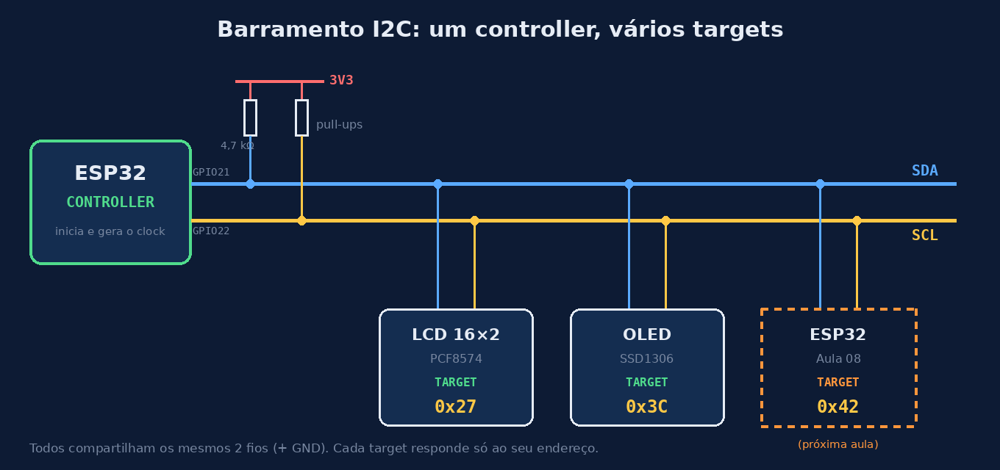
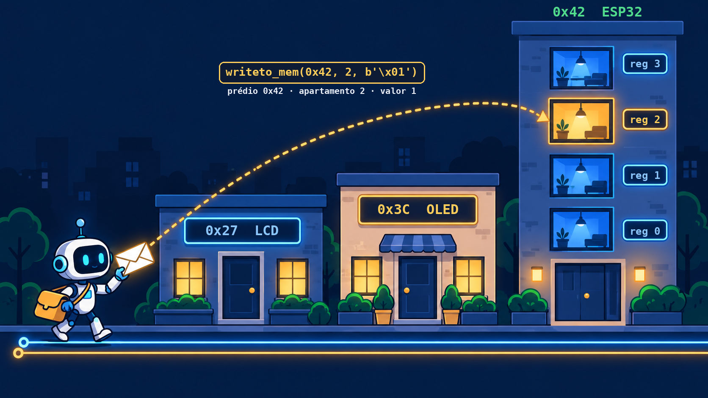
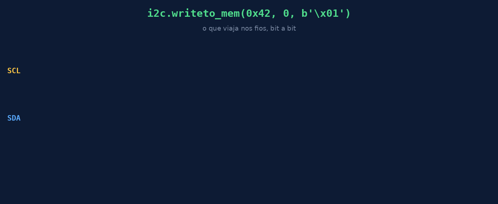

# Aula 07 — Anatomia de um periférico I2C

> **Seção 2 — O ESP32 como periférico.** Até aqui, o ESP32 sempre foi o **controller**: ele dava as ordens e o LCD e o OLED obedeciam. Nesta seção, vamos olhar para o **outro lado do fio**: o que existe dentro de um periférico, e como transformar um ESP32 em um.

⏱️ Tempo estimado: 30 minutos · 🖥️ Roda no Wokwi

---

## 🎯 Objetivos

Ao final desta aula, você será capaz de:

1. **Explicar** que *controller* e *target* são **papéis** no barramento, e não tipos de chip.
2. **Identificar** os dispositivos de um barramento I2C pelo endereço, usando `scan()`.
3. **Comandar** o LCD e o OLED **sem biblioteca**, enviando bytes com `writeto()`, e entender o que as bibliotecas do MC03 faziam por você.
4. **Consultar** a tabela de comandos de um datasheet e relacioná-la com o código de uma biblioteca.
5. **Descrever** um periférico como **um endereço + um mapa de registradores**.
6. **Projetar** o mapa de registradores do periférico que você vai construir na Aula 08.

---

## 💡 Conceito

### Controller e target são papéis

No I2C, quem **inicia** a comunicação e gera o clock (SCL) é o **controller**. Quem **responde** quando é chamado pelo seu endereço é o **target**.

| | Controller | Target |
|---|---|---|
| Inicia a conversa? | Sim | Não, só responde |
| Gera o clock (SCL)? | Sim | Não |
| Tem endereço? | Não precisa | Sim (ex.: `0x27`, `0x3C`) |
| No MC03 | ESP32 | LCD (PCF8574) e OLED (SSD1306) |

O PCF8574 e o SSD1306 são chips que **só sabem** ser target. Já o ESP32 pode fazer **os dois papéis**, e isso é a base desta seção.



### O que as bibliotecas escondiam

Quando você escreveu `lcd.putstr("Ola")` ou `oled.text(...)`, a biblioteca transformou isso em **bytes enviados para um endereço**. Por baixo, tudo se resume a duas funções:

```python
i2c.writeto(endereco, dados)                     # envia bytes para o dispositivo
i2c.writeto_mem(endereco, registrador, dados)    # envia bytes para um registrador
```

Nesta aula, vamos tirar a biblioteca do caminho e falar **direto** com os chips.

### Endereço + registradores

Pense em um periférico como um **prédio**:

- o **endereço** (`0x3C`) é o número do prédio no barramento;
- os **registradores** são os **apartamentos** lá dentro, cada um com uma função.

Para entregar um dado, o controller diz: *"prédio 0x42, apartamento 0, aqui está o valor 1"*. É exatamente isso que `writeto_mem(0x42, 0, b'\x01')` faz.



> Cada prédio é um dispositivo no barramento (0x27, 0x3C, 0x42). Dentro do prédio 0x42, cada andar é um registrador. Na figura, o controller entrega o valor 1 no **registrador 2**: `writeto_mem(0x42, 2, b'\x01')`.

O primeiro byte depois do endereço diz **onde** o dado deve ir (o registrador). Cada chip define seu próprio mapa:

| Chip | Como diferencia o destino do dado |
|---|---|
| PCF8574 (LCD) | Não tem registradores: cada byte vai direto para os 8 pinos de saída |
| SSD1306 (OLED) | Primeiro byte de controle: `0x00` = comando, `0x40` = dado de imagem |
| ESP32 target (Aula 08) | Nós vamos decidir! |

Veja o que acontece nos fios quando o controller executa `writeto_mem(0x42, 0, b'\x01')`:



> Repare nos bits **laranja (ACK)**: é o target respondendo "recebi!". Se ninguém responder, o controller gera um erro, e é isso que acontece quando um fio está solto.

---

## 🔌 Circuito

Mesmo barramento, dois periféricos:

| ESP32 | LCD 16×2 (PCF8574) | OLED SSD1306 |
|---|---|---|
| GPIO21 (SDA) | SDA | SDA |
| GPIO22 (SCL) | SCL | SCL |
| 3V3 | VCC | VCC |
| GND | GND | GND |

> 📝 **Pico:** SDA = GP4, SCL = GP5.

---

## 🧩 diagram.json (Wokwi)

▶️ **Projeto pronto no Wokwi:** [https://wokwi.com/projects/478080662685115393](https://wokwi.com/projects/478080662685115393)

Ou monte do zero colando este `diagram.json`:

```json
{
  "version": 1,
  "author": "Rogério Malta Branco",
  "editor": "wokwi",
  "parts": [
    { "type": "board-esp32-devkit-c-v4", "id": "esp", "top": 0, "left": 0, "attrs": {} },
    {
      "type": "wokwi-lcd1602",
      "id": "lcd",
      "top": -166.4,
      "left": 188,
      "attrs": { "pins": "i2c" }
    },
    {
      "type": "board-ssd1306",
      "id": "oled",
      "top": 60.74,
      "left": 221.03,
      "attrs": { "i2cAddress": "0x3c" }
    }
  ],
  "connections": [
    [ "esp:TX", "$serialMonitor:RX", "", [] ],
    [ "esp:RX", "$serialMonitor:TX", "", [] ],
    [ "esp:21", "lcd:SDA", "green", [ "h43.24", "v-175.8" ] ],
    [ "esp:22", "lcd:SCL", "blue", [ "h33.64", "v-48", "v-89.5" ] ],
    [ "esp:3V3", "lcd:VCC", "red", [ "v-38.4", "h148.99", "v-98.9" ] ],
    [ "esp:21", "oled:SDA", "green", [ "h43.24", "v-57.6", "h142.9" ] ],
    [ "esp:22", "oled:SCL", "blue", [ "h33.64", "v-48", "h142.67" ] ],
    [ "esp:3V3", "oled:VCC", "red", [ "v-38.4", "h263.01" ] ],
    [ "esp:GND.3", "oled:GND", "black", [ "h24.04", "v-76.8", "h133.37" ] ],
    [ "esp:GND.3", "lcd:GND", "black", [ "h24.04", "v-204.4" ] ]
  ],
  "dependencies": {}
}
```

> 💡 Esta aula **não usa** bibliotecas de display: não é preciso adicionar `i2c_lcd.py` nem `ssd1306.py`.

---

## 💻 Código

Nenhuma biblioteca de display: só `machine.I2C`.

```python
# Aula 07 — Falando com periféricos I2C sem biblioteca
from machine import I2C, Pin
import time

i2c = I2C(0, scl=Pin(22), sda=Pin(21), freq=100000)
# Pico: i2c = I2C(0, scl=Pin(5), sda=Pin(4), freq=100000)

LCD = 0x27      # PCF8574 do LCD
OLED = 0x3C     # SSD1306

# --- 1. Quem está no barramento? ---
achados = i2c.scan()
print("Endereços encontrados:", [hex(a) for a in achados])

# --- 2. LCD: PCF8574 não tem registradores ---
# Cada byte enviado vira o estado dos 8 pinos do PCF8574.
# No módulo do LCD, o bit 3 (0x08) controla a luz de fundo.
print("LCD: piscando a luz de fundo")
for _ in range(3):
    i2c.writeto(LCD, bytes([0x08]))   # bit 3 = 1 -> luz acesa
    time.sleep(0.5)
    i2c.writeto(LCD, bytes([0x00]))   # bit 3 = 0 -> luz apagada
    time.sleep(0.5)

# --- 3. OLED: SSD1306 usa um byte de controle ---
# 0x00 na frente avisa: "o que vem a seguir é COMANDO".
def oled_cmd(c):
    i2c.writeto(OLED, bytes([0x00, c]))

oled_cmd(0xAE)          # desliga o display
oled_cmd(0x8D)          # configura a bomba de carga...
oled_cmd(0x14)          # ...ligada (necessária para acender)
oled_cmd(0xAF)          # liga o display

# 0x40 na frente avisa: "o que vem a seguir é DADO de imagem".
# Cada byte de dado acende 8 pixels em coluna (1 bit = 1 pixel).
def oled_pagina(pagina, padrao):
    oled_cmd(0xB0 | pagina)     # escolhe a página (faixa de 8 linhas): 0 a 7
    oled_cmd(0x00)              # coluna 0 (parte baixa do endereço)
    oled_cmd(0x10)              # coluna 0 (parte alta do endereço)
    i2c.writeto(OLED, bytes([0x40]) + bytes([padrao]) * 128)   # 128 colunas

print("OLED: acendendo e apagando todos os pixels")
for _ in range(3):
    for pg in range(8):
        oled_pagina(pg, 0xFF)   # 0xFF = 11111111 -> 8 pixels acesos
    time.sleep(0.5)
    for pg in range(8):
        oled_pagina(pg, 0x00)   # 0x00 = 00000000 -> 8 pixels apagados
    time.sleep(0.5)

print("Fim: nenhuma biblioteca foi usada!")
```

### Como ler este código

- `writeto(LCD, bytes([0x08]))`: o PCF8574 recebe **um byte** e copia cada bit para um pino. Não existe "registrador": o byte **é** o estado dos pinos.
- `writeto(OLED, bytes([0x00, c]))`: o SSD1306 recebe **dois bytes**. O primeiro (`0x00`) diz *"isto é um comando"*, e o segundo é o comando em si. Esse primeiro byte faz o papel de um **registrador**.
- `writeto(OLED, bytes([0x40]) + ...)`: agora o primeiro byte é `0x40`, que diz *"o que vem é imagem"*. Os 128 bytes seguintes vão direto para a memória de vídeo, uma coluna de 8 pixels por byte.

### De onde vêm esses comandos?

Nenhum desses números foi inventado. Todo chip vem com uma **folha de dados** (*datasheet*): o manual do fabricante, que lista cada comando que o chip entende. Os códigos usados aqui estão na tabela de comandos do **datasheet do SSD1306**.

| Comando | O que faz no SSD1306 |
|---|---|
| `0xAE` | Desliga o display (modo *sleep*) |
| `0x8D`, `0x14` | Liga a **bomba de carga**, o circuito interno que gera a tensão alta que os pixels OLED precisam. Sem ela, nada acende |
| `0xAF` | Liga o display |
| `0xB0` a `0xB7` | Escolhe a **página** 0 a 7 (`0xB0 \| pagina`) |
| `0x00` e `0x10` | Posicionam o cursor na **coluna 0**: o endereço da coluna é dividido em duas metades de 4 bits, uma em cada comando |

**A prova de que a biblioteca faz o mesmo:** abra o arquivo `ssd1306.py` que você usou nas aulas 5 e 6 (está em `assets/libs/`). Lá estão os mesmos números, só que com nomes:

```python
SET_DISP = const(0xAE)          # 0xAE = desliga, 0xAE | 0x01 = 0xAF = liga
SET_CHARGE_PUMP = const(0x8D)   # seguido de 0x14, como no nosso código
```

Ou seja: quando você chamava `SSD1306_I2C(128, 64, i2c)`, a biblioteca enviava esta mesma sequência ao iniciar o display.

#### Como a memória de vídeo é organizada

A tela de 128×64 pixels é dividida em **8 páginas**, cada uma com 8 linhas de altura e 128 colunas. Cada **byte** de dado ocupa uma coluna de uma página: o **bit 0 é o pixel de cima** e o **bit 7, o de baixo**.

```
           coluna 0   coluna 1   ...   coluna 127
página 0   [byte]     [byte]     ...   [byte]      ← linhas 0 a 7
página 1   [byte]     [byte]     ...   [byte]      ← linhas 8 a 15
  ...
página 7   [byte]     [byte]     ...   [byte]      ← linhas 56 a 63
```

Por isso `oled_pagina()` envia **128 bytes** (uma página inteira) e o laço repete para as **8 páginas**: 8 × 128 = 1024 bytes cobrem a tela toda.

#### E o byte de controle?

O primeiro byte de cada envio ao SSD1306 tem dois bits com significado:

| Bit | Nome | Significado |
|---|---|---|
| 7 | Co | 1 = depois deste dado vem outro byte de controle |
| 6 | D/C# | 0 = **comando**, 1 = **dado** de imagem |

- `0x00` = `00000000`: comando (o que usamos em `oled_cmd`);
- `0x40` = `01000000`: dado de imagem;
- `0x80` = `10000000`: também é comando. É o valor que a biblioteca `ssd1306.py` usa em `write_cmd()`. Para um único comando por envio, `0x00` e `0x80` funcionam igual.

#### E o `0x08` do LCD?

O PCF8574 não tem comandos: ele copia os 8 bits para 8 pinos. Quem decide o que cada pino faz é a **plaquinha** soldada atrás do LCD. Nos módulos mais comuns (e no Wokwi), o pino P3 controla o transistor da luz de fundo. Por isso o bit 3 (`0x08`) liga e desliga o backlight.

> 🔎 **Hábito de profissional:** antes de usar um chip novo, procure o datasheet e a tabela de comandos. Biblioteca nenhuma faz algo que o datasheet não permita.

---

## 🔬 Experimento

1. Rode o código. Quais endereços o `scan()` mostra? Eles são os mesmos que você usava nas bibliotecas do MC03?
2. No Wokwi, desconecte o fio SDA do OLED e rode de novo. O que muda no `scan()`? E o que acontece na linha `oled_cmd`?
3. Troque o padrão `0xFF` por `0xAA` (`10101010`). O que aparece na tela? E com `0x0F`? Relacione cada bit com uma linha de pixels.
4. Na função `oled_pagina`, troque o `0x40` por `0x00`. Os pixels ainda acendem? Por quê? *Dica:* o que o SSD1306 entende quando o primeiro byte é `0x00`?
5. Por que o LCD **não precisa** de byte de controle e o OLED precisa?

---

## 🏆 Desafio

### Principal: projete um periférico

Na Aula 08, você vai transformar um ESP32 em um **periférico com LED RGB**, no endereço `0x42`. Antes de programar, **projete o mapa de registradores** dele no papel. Ele deve permitir:

- ligar um efeito arco-íris;
- desligar (piscando em vermelho);
- definir uma **cor fixa** (R, G, B de 0 a 255);
- informar ao controller se está ligado ou desligado.

Preencha a tabela:

| Registrador | Nome | Quem escreve? | Valores | Significado |
|---|---|---|---|---|
| 0 | | | | |
| 1 | | | | |
| ... | | | | |

Depois, escreva a linha `writeto_mem(...)` que o controller usaria para cada ação.

### Bônus

Explique por que um periférico com mapa de registradores é **mais fácil de reaproveitar** em outros projetos do que um que recebe "comandos soltos".

---

## 📌 Resumo

- **Controller** inicia a conversa e gera o clock. **Target** responde ao seu endereço. São papéis, e o ESP32 pode fazer os dois.
- `scan()` lista os endereços presentes no barramento.
- Por baixo de toda biblioteca I2C existem `writeto()` e `writeto_mem()`.
- Os códigos de comando vêm do **datasheet** do chip; a biblioteca só dá nomes a eles.
- Um periférico = **endereço + mapa de registradores**.
- Cada chip define seu mapa: o PCF8574 não tem registradores; o SSD1306 usa um byte de controle (`0x00` comando, `0x40` dado).

➡️ **Próxima aula:** você vai construir o seu próprio periférico com um ESP32, implementando o mapa que acabou de projetar.

---

[← Aula 06](aula06-oled-graficos.md) · [Início](../index.md) · [Aula 08 →](aula08-esp32-target.md)
