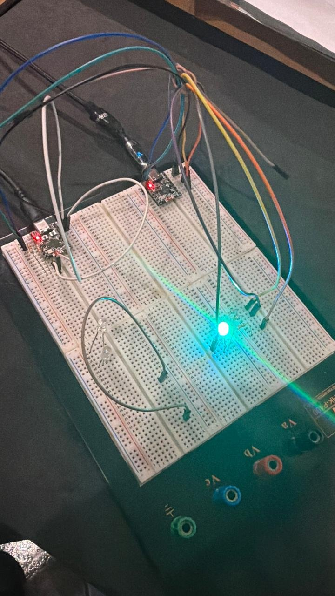
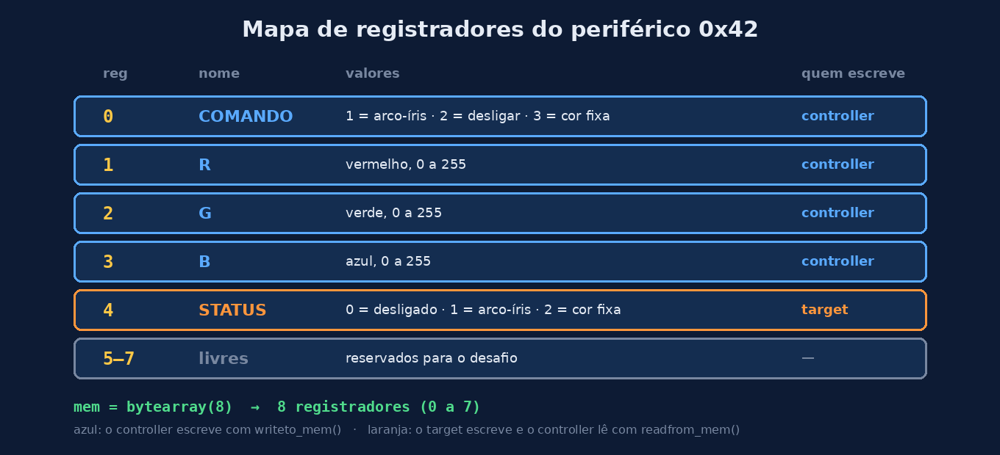
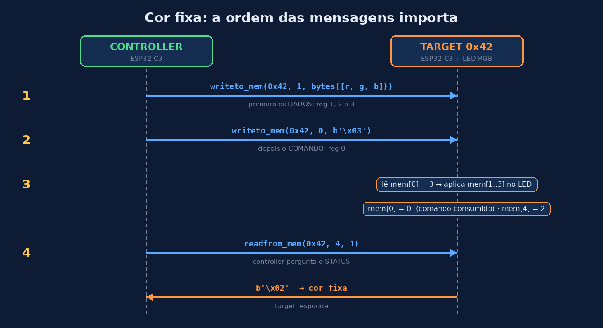

# Aula 08 — ESP32 como target I2C

> **Seção 2 — O ESP32 como periférico.** Na Aula 7 você descobriu que um periférico é **um endereço + um mapa de registradores**, e projetou no papel o mapa de um periférico com LED RGB. Agora vamos **construir um periférico de verdade**, usando um segundo ESP32.

⏱️ Tempo estimado: 30 minutos · 🔧 **Bancada** (duas placas ESP32-C3 SuperMini)

> ⚠️ **Por que não no Wokwi?** O simulador ainda não implementa o ESP32 no papel de target I2C. O código abaixo foi testado no hardware real (MicroPython 1.25 ou mais novo).

---

## 🎯 Objetivos

Ao final desta aula, você será capaz de:

1. **Configurar** um ESP32 como target I2C com `I2CTarget`, no endereço `0x42`.
2. **Explicar** como o `mem` funciona como banco de registradores, preenchido pelo hardware em segundo plano.
3. **Enviar** comandos do controller para o target com `writeto_mem()`.
4. **Identificar** um problema real do código (o comando que "fica parado" no registrador) e corrigi-lo.
5. **Ampliar** o periférico seguindo um mapa de registradores, incluindo a leitura do estado com `readfrom_mem()` (desafio).

---

## 💡 Conceito

### O `mem` é o banco de registradores

No target, criamos um `bytearray` e o entregamos ao `I2CTarget`:

```python
mem = bytearray(16)
t = I2CTarget(0, addr=0x42, mem=mem, scl=Pin(7), sda=Pin(6))
```

A partir daí, **o hardware I2C escreve no `mem` sozinho**, em segundo plano. Quando o controller executa `writeto_mem(0x42, 0, b'\x01')`, o target recebe o byte e o guarda em `mem[0]`, sem que o programa do target precise fazer nada. O laço principal só precisa **olhar** o `mem` de tempos em tempos.

> 📏 **Regra do tamanho:** o `mem` deve ser **maior** que o maior bloco que o controller vai enviar, contando o byte do registrador. Com `bytearray(16)` temos folga para os registradores 0 a 15.

### O mapa desta aula

Nesta aula usamos **só o registrador 0**, como registrador de comando:

| Registrador | Quem escreve | Valores |
|---|---|---|
| 0 (COMANDO) | controller | `1` = ligar o arco-íris · `2` = desligar · `0` = parado |

No desafio, você vai ampliar esse mapa para incluir cor fixa e um registrador de estado.

---

## 🔌 Circuito (bancada)

| Controller (C3) | Target (C3) | Observação |
|---|---|---|
| GPIO6 (SDA) | GPIO6 (SDA) | + resistor de 4,7 kΩ para 3V3 |
| GPIO7 (SCL) | GPIO7 (SCL) | + resistor de 4,7 kΩ para 3V3 |
| GND | GND | **obrigatório** |

No **target**, o LED RGB de catodo comum:

| Target | LED RGB |
|---|---|
| GPIO0 | R (via resistor de 220 Ω) |
| GPIO1 | G (via resistor de 220 Ω) |
| GPIO3 | B (via resistor de 220 Ω) |
| GND | catodo (perna mais longa) |

> 📌 **Pinos evitados:** GPIO2, GPIO8 e GPIO9 são pinos de *strapping* do C3 (definem o modo de boot). O GPIO8 também é o LED da placa.



*Montagem real na bancada: duas ESP32-C3 SuperMini ligadas por I2C e o LED RGB no target. Montagem e foto: Noah Teodoro Ceiglinski Domingues.*

### ✅ Checklist de montagem

- [ ] GND das duas placas ligados entre si
- [ ] SDA com SDA, SCL com SCL (não cruzar!)
- [ ] Um resistor de 4,7 kΩ do SDA para 3V3 e outro do SCL para 3V3 (só de um lado)
- [ ] LED com a perna longa (catodo) no GND e um resistor em cada cor
- [ ] **Target** ligado e rodando **antes** do controller

---

## 💻 Código

> 👏 **Créditos:** os códigos do target e do controller, a montagem na bancada, a foto e o vídeo desta aula são de autoria de **Noah Teodoro Ceiglinski Domingues**, aluno do Curso Técnico em Automação Industrial (modalidade subsequente) do IFRS Campus Rio Grande.

### Target (`main.py` da placa com o LED)

```python
from machine import I2CTarget, Pin, PWM
import time

INVERTIDO = False   # catodo comum

pr = PWM(Pin(0), freq=1000, duty_u16=0)
pg = PWM(Pin(1), freq=1000, duty_u16=0)
pb = PWM(Pin(3), freq=1000, duty_u16=0)

def cor(r, g, b):          # valores de 0.0 a 1.0
    for p, v in ((pr, r), (pg, g), (pb, b)):
        d = int(v * 65535)
        p.duty_u16(65535 - d if INVERTIDO else d)

def matiz(h):              # h de 0.0 a 1.0 -> cor do arco-iris
    i = int(h * 6)
    f = h * 6 - i
    q = 1 - f
    return [(1, f, 0), (q, 1, 0), (0, 1, f),
            (0, q, 1), (f, 0, 1), (1, 0, q)][i % 6]

mem = bytearray(16)        # mem[0]: 1 = ligar, 2 = desligar, 0 = parado
t = I2CTarget(0, addr=0x42, mem=mem, scl=Pin(7), sda=Pin(6))
print("target pronto, aguardando")

cor(0, 0, 0)
ligado = False
h = 0.0

while True:
    cmd = mem[0]
    if cmd == 1 and not ligado:
        print("recebido: ligar")
        ligado = True
        h = 0.0
    elif cmd == 2:
        print("recebido: desligar")
        ligado = False
        for _ in range(3):
            cor(1, 0, 0)
            time.sleep_ms(300)
            cor(0, 0, 0)
            time.sleep_ms(300)
        mem[0] = 0
        print("desligado")

    if ligado:
        cor(*matiz(h))
        h = (h + 0.003) % 1.0   # volta completa de cor em ~6,7 s
    time.sleep_ms(20)
```

### Controller (`main.py` da outra placa)

```python
from machine import I2C, Pin
import time

ENDERECO = 0x42
i2c = I2C(0, scl=Pin(7), sda=Pin(6), freq=100000)
print("scan:", i2c.scan())      # deve aparecer [66]

for s in range(5, 0, -1):
    print("enviando em", s)
    time.sleep(1)

i2c.writeto_mem(ENDERECO, 0, b'\x01')
print("sinal de ligar enviado")

for s in range(30, 0, -1):
    print("avisando em", s)
    time.sleep(1)

i2c.writeto_mem(ENDERECO, 0, b'\x02')
print("sinal de desligar enviado")
```

### Como ler este código

**No target:**

- `PWM(Pin(0), freq=1000, duty_u16=0)`: cada cor do LED é controlada por PWM. O `duty_u16` vai de 0 (apagado) a 65535 (brilho máximo).
- `cor(r, g, b)`: recebe cada cor de 0.0 a 1.0 e converte para o PWM. Se o LED for de anodo comum, `INVERTIDO = True` inverte a lógica.
- `matiz(h)`: transforma um número de 0.0 a 1.0 em uma cor do arco-íris, passando por 6 trechos (vermelho → amarelo → verde → ciano → azul → magenta).
- `I2CTarget(0, addr=0x42, mem=mem, ...)`: **é aqui que o ESP32 vira periférico.** Ele passa a responder no endereço `0x42` e a guardar no `mem` tudo o que o controller escrever.
- O laço `while True` olha `mem[0]` a cada 20 ms. Esse jeito de conferir repetidamente é chamado de *polling*.
- No desligar, o target escreve `mem[0] = 0` depois das piscadas: ele "limpa" o comando para não piscar de novo na próxima volta.

**No controller:**

- `i2c.scan()` confirma que o target está no barramento: `[66]` é `0x42` em decimal.
- `writeto_mem(ENDERECO, 0, b'\x01')`: escreve o valor `1` no **registrador 0** do target. É exatamente a mesma função que usaríamos para um sensor ou um display comercial: para o controller, o ESP32 target é só mais um endereço no barramento.

### O que esperar

**No Shell do controller:**

```
scan: [66]
enviando em 5 ... 1
sinal de ligar enviado
avisando em 30 ... 1
sinal de desligar enviado
```

**No Shell do target:**

```
target pronto, aguardando
recebido: ligar
recebido: desligar
desligado
```

**No LED:** o arco-íris gira por 30 s (umas 4 voltas completas de cor), depois vêm 3 piscadas vermelhas e o LED apaga.

<video src="../assets/fig12-funcionando-bancada.mp4" width="320" autoplay loop muted playsinline controls></video>

*O periférico funcionando na bancada: o arco-íris e, no final, as piscadas vermelhas do desligar. Vídeo: Noah Teodoro Ceiglinski Domingues.* ([abrir o vídeo](../assets/fig12-funcionando-bancada.mp4))

---

## 🔬 Experimento

1. Com tudo rodando, desconecte o fio de GND entre as placas e reinicie o controller. O que o `scan()` mostra?
2. Mude o controller para enviar o comando `1`, esperar 5 s e enviar `1` **de novo**. O arco-íris recomeça do vermelho? Por quê? *Dica:* olhe a condição `cmd == 1 and not ligado`.
3. Depois do "ligar", qual valor fica guardado em `mem[0]`? E depois do "desligar"? Por que o código zera o `mem[0]` só no desligar?
4. Mude o endereço no target para `0x43` (só no target). O que acontece no controller? Por quê?
5. Envie o comando `5`, que não existe. O que o target faz? Isso é um problema?

---

## 🏆 Desafio

### Principal: periférico completo

Amplie o periférico seguindo este mapa de registradores (compare com o que você projetou na Aula 7):



O que você precisa implementar:

1. **Comando consumido:** em **todo** comando, o target faz `mem[0] = 0` depois de agir. Assim, enviar `1` duas vezes reinicia o arco-íris (resolve o experimento 2).
2. **Cor fixa (comando 3):** o target lê `mem[1]`, `mem[2]` e `mem[3]` (0 a 255) e acende essa cor. Lembre que `cor()` espera valores de 0.0 a 1.0.
3. **STATUS (registrador 4):** o target grava ali o modo atual (0 desligado, 1 arco-íris, 2 cor fixa). O controller lê com:

```python
estado = i2c.readfrom_mem(0x42, 4, 1)[0]   # lê 1 byte a partir do registrador 4
```

⚠️ **A ordem importa.** Para a cor fixa, o controller precisa enviar **primeiro os dados** e **depois o comando**. Se o comando chegar antes, o target pode acender a cor antiga:



*Teste:* inverta a ordem e coloque um `time.sleep_ms(500)` entre as duas escritas. Qual cor aparece primeiro? Agora tire a pausa: o erro some? *(Ele fica raro, mas não impossível: é o tipo de defeito que aparece "às vezes" e dá muito trabalho para achar.)*

### Bônus 1: brilho

Use o registrador 5 como **BRILHO** (0 a 100 %), aplicado tanto ao arco-íris quanto à cor fixa. Que valor inicial faz sentido se o controller nunca escrever nesse registrador?

### Bônus 2: sem *polling*

O `I2CTarget` também pode **avisar** o programa quando uma escrita termina, chamando uma função sua (*callback* de interrupção). Pesquise o método `irq()` do `I2CTarget` na documentação do MicroPython e tente usá-lo no lugar de conferir `mem[0]` a cada 20 ms.

---

## 🧯 Se não funcionar

| Sintoma | Causa provável |
|---|---|
| `scan()` mostra `[]` | GND não ligado, faltam pull-ups, ou SDA/SCL trocados |
| `scan()` mostra `[66]` mas o LED não muda | O target não está rodando o `main.py`, ou o LED está invertido (teste `INVERTIDO = True`) |
| `OSError: [Errno 116] ETIMEDOUT` | O target travou ou foi desligado durante a comunicação |
| Funciona às vezes | Fios longos ou mal encaixados; pull-ups internos sozinhos não bastam |
| `ImportError: I2CTarget` | Firmware antigo no target: atualize para MicroPython 1.25 ou mais novo |

---

## 📌 Resumo

| Conceito | No código |
|---|---|
| Criar o periférico | `I2CTarget(0, addr=0x42, mem=mem, ...)` |
| Registradores | posições do `mem` (`mem[0]`, `mem[1]`...) |
| Controller escreve | `writeto_mem(0x42, registrador, dados)` |
| Controller lê | `readfrom_mem(0x42, registrador, quantidade)` |
| Target confere comandos | *polling*: olha o `mem` a cada volta do laço |
| Limpar o comando | o target faz `mem[0] = 0` depois de agir |

➡️ **Próxima aula:** vamos juntar tudo em um **projeto integrador**: o controller comanda o LED RGB e mostra o estado do periférico no **OLED**.

---

[← Aula 07](aula07-anatomia-periferico-i2c.md) · [Início](../index.md) · Aula 09 *(em breve)*
